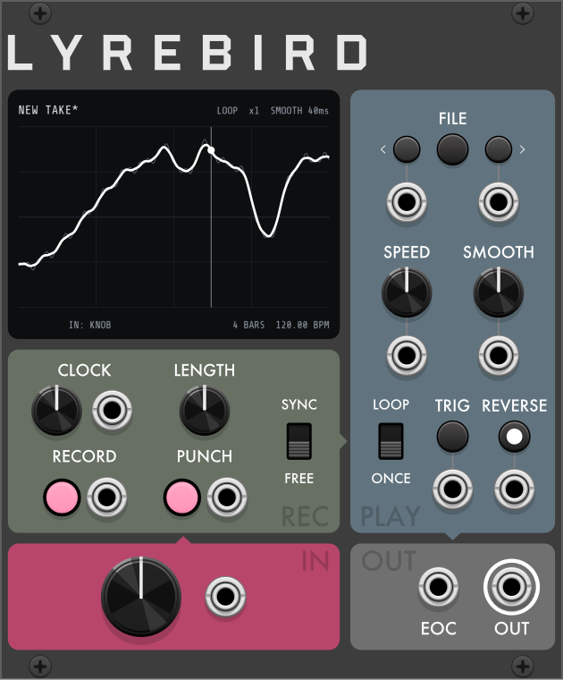

# Lyrebird

**Lyrebird** is a gesture and CV recorder for [VCV Rack](https://vcvrack.com) and the [4ms MetaModule](https://4mscompany.com/metamodule). It records one lane of voltage from its knob or a CV input and plays it back as a loop or one-shot, synced to the bar or at its recorded speed. Takes can be punched in, sped up, reversed, smoothed, and saved as WAV files. It is one of Robot Boy's three complex modulators, with [Skylark](Skylark.md) and [Weaver](Weaver.md), and uses the same clock scheme.

---

## Overview

- Lyrebird holds one *take*: a recorded voltage lane, up to 3 minutes, at 1,000 samples per second.
- With no take, **OUT** passes the current source (knob or CV).
- **Time** (context menu):
  - **Sync** (default): the take is a whole number of bars long (set by **LENGTH**) and its position is derived from the bar count. Tempo changes stretch it.
  - **Free**: the take plays at its recorded duration, independent of the clock.
- **Play** (context menu): **Loop** (default) or **Once** (one pass per **TRIG**).
- The bar count comes from the **CLOCK** knob or an external clock. One bar = four beats, as on Skylark and Weaver.

---

## Controls

### CLOCK and LENGTH

- **CLOCK** knob: 20–300 BPM, default 120, in 0.01 BPM steps.
- **CLOCK** input: overrides the knob. **Clock pulses per cycle** sets the pulses per bar (default 4). From the second pulse, the tempo is measured and averaged over one bar of pulses, and the bar count is phase-locked to the clock. After a gap of more than about two pulses, the next pulse resets the bar count to the start of a bar.
- **LENGTH**: length of a new Sync take: 1/4, 1/2, 1, 2, 4, 8 or 16 bars (default 1). Read when recording starts. No effect on Free takes.

### RECORD and PUNCH

- **RECORD** button and gate input: records a new take, replacing the current one (recoverable with **Undo last take**). Default: press to start, press again to stop. A Sync take stops automatically at LENGTH. The light is solid while recording and blinks while armed.
- **PUNCH** button and gate input: overwrites the take at the playhead while playback continues. Press to start, press again to stop. Length, timing and mode are unchanged.
- **Record buttons** and **Start recording** in the context menu change the behavior of both. See **Recording**.

### INPUT: knob and CV jack

- **Knob**: −5 to +5 V (default), or 0 to 10 V with **Knob range**.
- **CV jack**: when patched, the CV is recorded instead of the knob, −10 to +10 V.
- The display footer shows the active source (`IN: KNOB` or `IN: CV`).
- Sample rate is 1,000 Hz: edges sharper than 1 ms are softened.

### SPEED, SMOOTH, TRIG and REVERSE

- **SPEED**: playback rate, x1/4 to x4, default x1. In Sync it snaps to x1/4, x1/2, x1, x2, x4 so the take stays bar-aligned. In Free it is continuous. SPEED CV: 1 V/octave, extending the range to x1/16–x16. Recording is always real-time.
- **SMOOTH**: zero-phase smoothing of playback, off (default) to a 1 s window, on a curved scale. The window is in take time (at x2, 100 ms covers 50 ms of real time). Wraps at the loop point in Loop; stops at the ends in Once. Does not alter the recording or saved files. SMOOTH CV: +10 V spans the knob's range.
- **TRIG** button and input: restart the bar count and the take (from the end when reversed). In Once, starts a pass. With a clock patched, the next pulse is treated as the downbeat.
- **REVERSE** button and gate input: play backward while held or while the gate is above 1 V. The light shows the current direction. Sync takes stay bar-aligned. **Reverse button → Latch** makes each press or rising gate toggle direction.

### Outputs

- **OUT**: the take, clamped to ±10 V. While recording or punching, OUT follows the live source through SMOOTH (as a causal lag).
- **EOC**: 10 V, 1 ms trigger at each loop wrap and at the end of each Once pass. Not fired by TRIG.

---

## Display

- **Header, left:** take name: file name in capitals, `NEW TAKE` if unsaved, or `EMPTY`. `*` = modified since saved or opened.
- **Header, right:** `LOOP` or `ONCE`, playback speed (`x1`, `x1/2`, `x1.41`), and SMOOTH (`SMOOTH OFF`, `SMOOTH 40ms`).
- **Trace:** the whole take. Raw recording in grey; output after SMOOTH in white. Sync takes show bar lines. Vertical scale: the knob's range, extended if the take exceeds it.
- **Playhead:** line and dot at the current position.
- **While writing:** new recording drawn in magenta; during a punch, the replaced section is magenta on a magenta band.
- **Footer, left:** `REC`, `PUNCH`, blinking `ARMED`, or a file message (3 s).
- **Footer, middle:** the source for the next recording: `IN: KNOB` or `IN: CV`.
- **Footer, right:** Sync: take length and tempo (`4 BARS  120.00 BPM`); with no take, or for 2 s after LENGTH is turned, the LENGTH setting. Free: take length in seconds (`12.3 S`), or `FREE` with no take.

---

## Playback modes

| Mode | Behavior |
|---|---|
| Sync + Loop | Loops with position derived from the bar count. |
| Sync + Once | Each TRIG plays one pass at the current tempo. TRIG during a pass restarts it. |
| Free + Loop | Loops at recorded speed × SPEED. TRIG restarts. |
| Free + Once | As Sync + Once, at recorded speed × SPEED. |

- Between Once passes, and after loading a take before the first TRIG, OUT holds the take's last value. **Idle output** can set it to the first value or 0 V. When reversed, first and last follow the playback direction.
- Changing **Time** applies to the current take:
  - Sync take in Free: plays at its recorded tempo × SPEED.
  - Free take in Sync: stretched to the nearest LENGTH value at its recorded tempo.

---

## Recording

### Sync takes

- Recording is positioned by the bar count, not by the RECORD press. Starting two bars into a four-bar take records from bar 3 and wraps to fill bars 1–2. The bar count starts at the last TRIG or at patch start. To start a take at the press, send the same gate to TRIG and RECORD.
- Recording stops after LENGTH bars of clock, including across tempo changes. If stopped early, the rest of the take holds the last recorded value.
- In Once, the take starts at the RECORD press, so it plays from its beginning on the next TRIG. The bar count is unaffected.
- Sync takes over 3 minutes (16 bars below about 21 BPM) are recorded at a reduced sample rate.

### Free takes

- Recording starts at RECORD and stops at the next press. The take loops from its start.
- At 3 minutes recording stops; the display shows `LIMIT 3 MIN`.

### Punch-in

- PUNCH writes at the playhead at any SPEED, in either direction, in Sync or Free. In Loop, a punch can continue past the loop point.
- Both ends crossfade over 10 ms, in the output and in the recorded data.
- In Once, punching works only during a pass and ends with the pass.
- With no take, PUNCH records a new take, as RECORD does.
- RECORD during a punch ends the punch and starts a new take.

### Gate and armed recording

- **Record buttons → Press**: RECORD and PUNCH (buttons and inputs) write only while held high. Sync takes still stop at LENGTH.
- **Start recording → On first movement**: a press arms recording (light and `ARMED` blink). Writing starts when the source moves more than 0.05 V. Press again (or release, in Press mode) to cancel. Applies to PUNCH too.

### Undo

- **Undo last take** (context menu) restores the take from before the last RECORD, PUNCH or file load (including FILE ‹ ›). Choosing it again swaps back. One level only.
- In VCV Rack, these actions are also in Rack's undo history (Ctrl+Z / Ctrl+Shift+Z).
- Undoing a menu setting does not change the take. **Initialize** resets controls and menu settings (Time: Sync, Play: Loop) but keeps the take.

---

## Files

### FILE buttons

- **SAVE** (center button): saves to the current folder as the next free name (`LYREBIRD-001.wav`, `LYREBIRD-002.wav`, …) without a dialog. Shows `SAVED LYREBIRD-001` and clears `*`.
- **‹ ›**: load the previous/next WAV file in the current folder (alphabetical, wrapping). If the current take is not one of those files, › loads the first and ‹ the last. The inputs below do the same on a trigger. Undoable with **Undo last take**. In VCV Rack, if the current folder doesn't exist, they open the Open… dialog.
- **Open…** and **Save as…** (context menu): file dialogs. `.wav` is appended to names without it.
- *Current folder*: the folder of the last file opened or saved; saved with the patch. Default in VCV Rack: `RobotBoy/Lyrebird` in the Rack user folder (Help → Open user folder), created on first save. MetaModule: see **MetaModule**.

### Messages

Shown in the footer for 3 s:

| Message | Meaning |
|---|---|
| `SAVED …` / `LOADED …` | File name. |
| `NOTHING TO SAVE` | No take. |
| `SAVE FAILED` | File could not be written. |
| `CANT OPEN`, `NOT A WAV`, `UNSUPPORTED`, `EMPTY FILE` | File could not be loaded; take unchanged. |
| `TRUNCATED TO 3 MIN` | File longer than 3 minutes; first 3 minutes loaded. |
| `NO FILES` | No WAV files in the current folder. |
| `BUSY` | Previous file operation still running. |

Loading a file during recording or punching discards the data being written.

### WAV format

- Saved files: mono, 32-bit float, 1,000 Hz (lower for Sync takes over 3 minutes). Full scale = ±10 V.
- A metadata chunk stores Time mode, length in bars or seconds, and recorded tempo. Files without it load as Free takes.
- Other WAV files can be loaded: 8/16/24/32-bit integer or 32/64-bit float, any sample rate. First channel only, resampled to 1,000 Hz, full scale = ±10 V, loaded as a Free take (120 BPM if played in Sync). First 3 minutes only.

### Takes in the patch

The take is also stored in the patch at 16-bit resolution (about 0.3 mV steps), so the patch does not depend on the WAV file. A 3-minute take adds about 480 KB to the patch.

---

## Context menu

In VCV Rack, right-click the panel; on MetaModule, open Options.

- **Time**: **Sync** (default) or **Free**.
- **Play**: **Loop** (default) or **Once**.
- **Knob range**: ±5 V (default) or 0–10 V.
- **Record buttons**: **Latch** (default; rising edges toggle) or **Press** (gate level). Applies to RECORD, PUNCH and their inputs.
- **Reverse button**: **Press** (default; reversed while held or gate high) or **Latch** (each press or rising edge toggles; direction saved with the patch). Changing it resets playback to forward.
- **Start recording**: **On press** (default) or **On first movement**.
- **Idle output** (Once, between passes): **Last value** (default), **First value** or **0 V**.
- **Clock pulses per cycle**: 1, 2, 4 (default), 8, 16, 24, 32, 48, 96 pulses per bar.
- **Open…**: load a WAV file.
- **Save as…**: save with a chosen folder and name.
- **Undo last take**: swap with the previous take.

---

## MetaModule

All panel functions work on MetaModule, including file operations. Differences:

- **Display:** the header omits SMOOTH, file messages replace the take name, and `REC`, `PUNCH` or `ARMED` replaces the source in the footer.
- **Folders:** MetaModule cannot create folders; create one from a computer. The default folder is the first that exists of: `RobotBoy/Lyrebird`, `Lyrebird`, `RobotBoy` on the SD card; the same on a USB drive; the SD card root; the USB drive root. Checked on each use. If a saved folder is missing, the default is used.
- **No card or drive:** SAVE opens the Save as dialog. ‹ › and the FILE inputs show `NO FOLDER` and do not open a dialog.
- **Internal storage:** selectable in Save as…, but intended for patches.
- **Undo:** **Undo last take** works; there is no Ctrl+Z history.
- **Off screen:** file operations continue while the module is not displayed.
- **Cross-platform patches:** takes and settings transfer between VCV Rack and MetaModule. A folder saved on the other platform is ignored in favor of the default.
