# Robot Boy

**Robot Boy** is a plugin for [VCV Rack](https://vcvrack.com) and the [4ms MetaModule](https://4mscompany.com/metamodule). It contains:

* [Mutable Instruments Beads](#beads), split into three modules plus a visualizer.
* Three [complex modulators](#modulators).
* A [stereo looper](#loopers) with four independent playheads, and its smaller sibling.
* Three characterful [filter emulations](#filters).
* And a [tuner](#tune).

---
<a id="beads"></a>
## Beads, in three modules and a visualizer

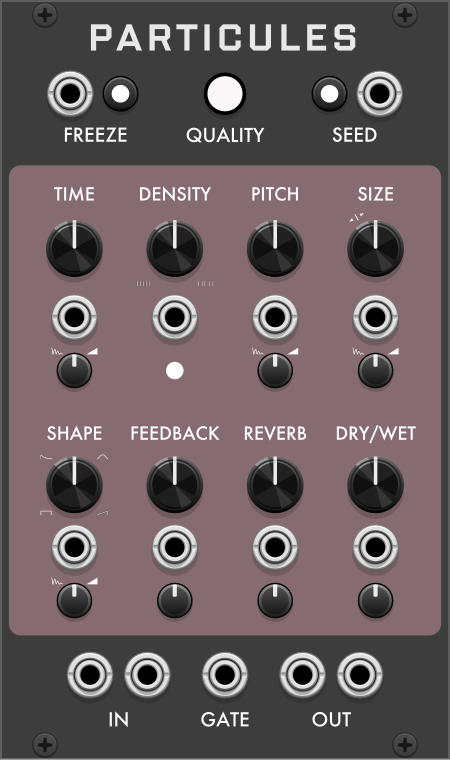
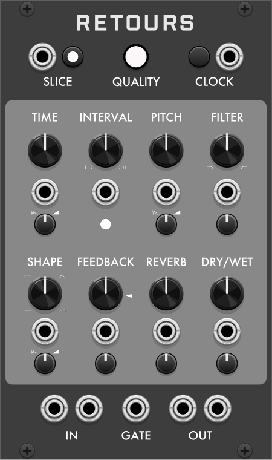
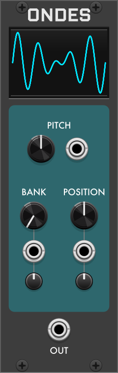
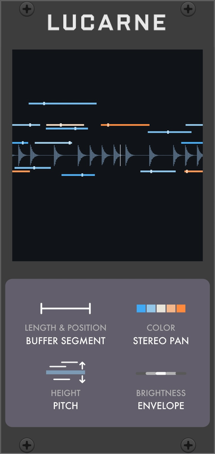

These modules split the Mutable Instruments Beads [source code](https://github.com/pichenettes/eurorack/tree/master/beads) into three parts and add a display expander.

- **[Particules](Particules.md):** Beads’s granular texture processor.
- **[Retours](Retours.md):** Beads’s hidden delay mode. 
- **[Ondes](Ondes.md):** Beads’s secret wavetable oscillator. 
- **[Lucarne](Lucarne.md):** A visualizer for Particules and Retours.

<a id="modulators"></a>
## Complex modulators

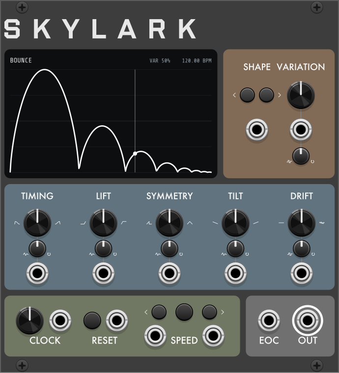
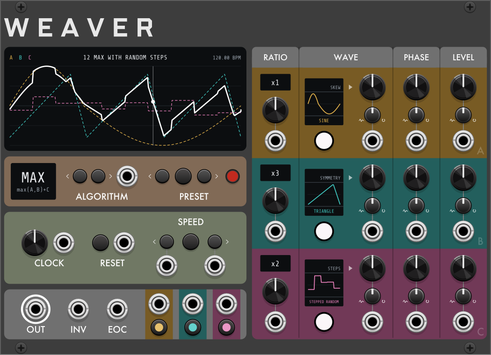
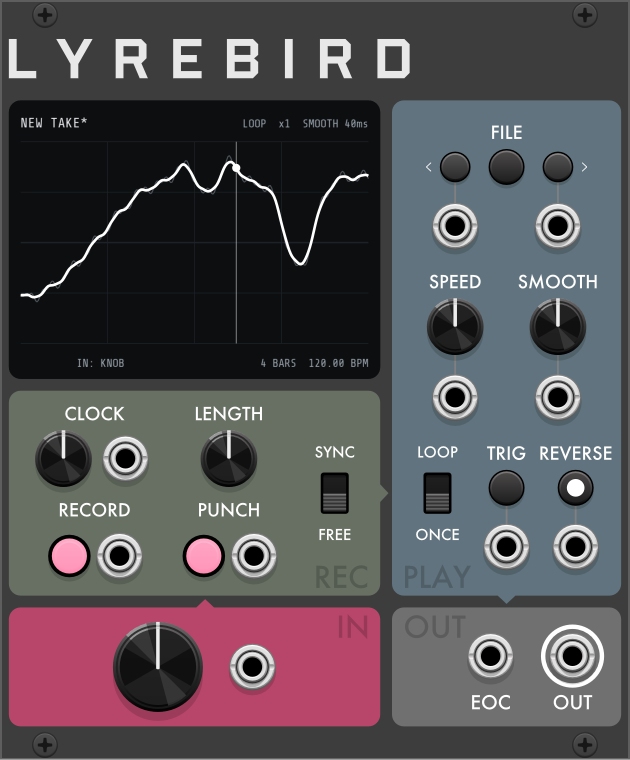

Three tempo-synced modulation sources.

- **[Skylark](Skylark.md):** Structured gestures — a bouncing ball, a ratchet, a heartbeat, a chirp — looped and tweaked.
- **[Weaver](Weaver.md):** Three simple operators combined into one shape.
- **[Lyrebird](Lyrebird.md):** A gesture and CV recorder.

<a id="loopers"></a>
## Loooop + Löp

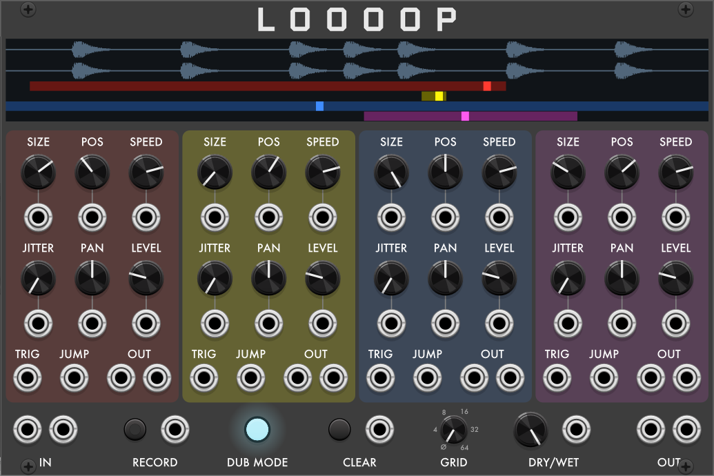
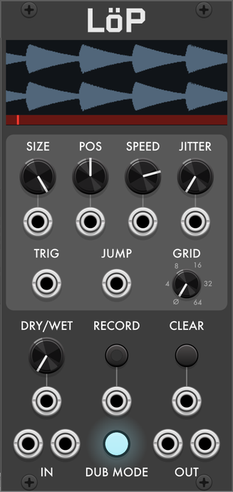

Capture a loop and play it back with four independent playheads, each with its own speed, position, length, and jitter. Löp is the single-playhead version. [**[Manual]**](Loooop.md)

<a id="filters"></a>
## Filters

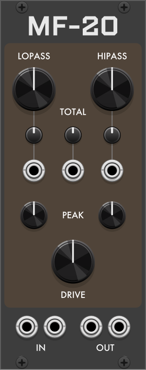
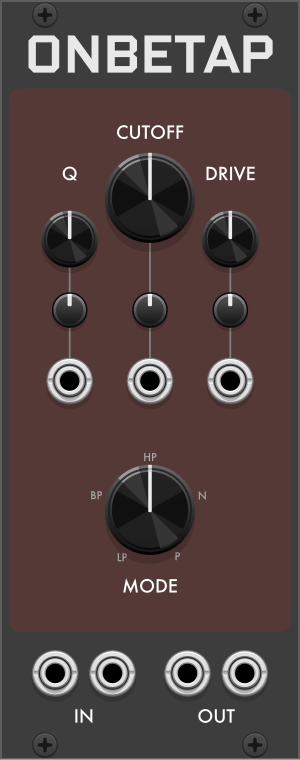
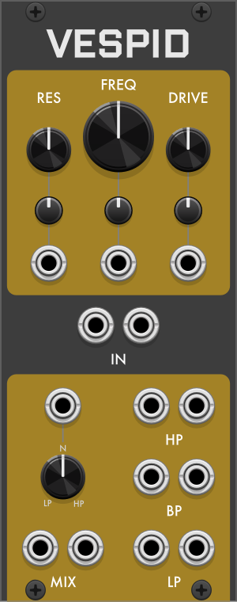
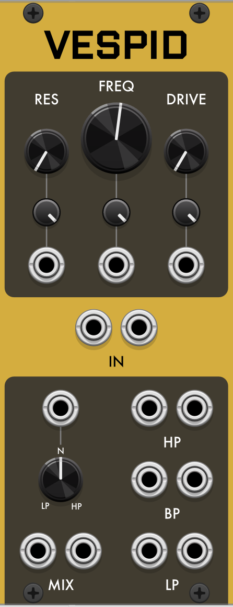

Three stereo filters, each modeled on original circuits. [**[Manual]**](Filters.md).

- **[MF-20](Filters.md#mf-20--the-korg-ms-20-filter):** The Korg MS-20 filter, switchable between the OTA and Korg35 revisions.
- **[Onbetap](Filters.md#onbetap--the-formanta-polivoks-filter):** The Soviet Polivoks filter.
- **[Vespid](Filters.md#vespid--the-edp-wasp-filter):** The buzzy EDP Wasp filter, in its original British or reimplemented German flavors.

<a id="tune"></a>
## Tune

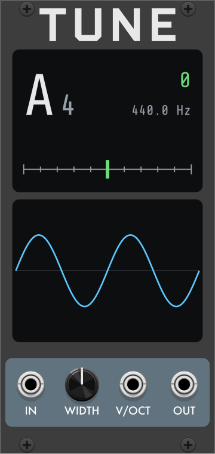

A tuner and scope with a V/oct output and an audio thru. [**[Manual]**](Tune.md)

## To install

- **VCV Rack:** download the `.vcvplugin` for your OS from [Releases](https://github.com/gabriel-roth/RobotBoy/releases), place it in `<Rack user folder>/plugins-<os>-<arch>/` (Rack menu: Help → Open User Folder), then restart Rack.
- **MetaModule** (firmware 2.3 or later): download the `.mmplugin` from [Releases](https://github.com/gabriel-roth/RobotBoy/releases), copy it to a `metamodule-plugins` folder (or the root) of an SD card or USB drive, then Scan Disks on the device and select it.

## To build

- **VCV Rack:** requires the [Rack SDK](https://vcvrack.com/downloads).
  ```
  git clone https://github.com/gabriel-roth/RobotBoy
  cd RobotBoy
  make RACK_DIR=<path-to-Rack-SDK> dist
  ```
- **MetaModule:** requires an `arm-none-eabi` cross toolchain and a checkout of [metamodule-plugin-sdk](https://github.com/4ms/metamodule-plugin-sdk) (tag `api-v2.3.0` or later).
  ```
  cmake -S metamodule -B metamodule/build -DMETAMODULE_SDK_DIR=<path-to-metamodule-plugin-sdk>
  cmake --build metamodule/build
  ```
  Output: `metamodule/metamodule-plugins/RobotBoy.mmplugin`.

## Repository layout

One source tree builds both the VCV Rack plugin and the MetaModule plugin.

- **The VCV Rack plugin** is laid out as usual: `Makefile`, `plugin.json`, `src/` and `res/` (panel SVGs) at the top level.
  - `src/beads/vendor/` is the Mutable Instruments Beads and stmlib code (MIT), vendored with RobotBoy's changes kept in one patch file (see its `NOTICE.md`). `src/beads/host/` adapts it for Particules, Retours and Ondes.
- **`metamodule/`** builds the same sources for the 4ms MetaModule with CMake. It also holds the MetaModule panel images and Loooop/Löp's MetaModule-specific code. The VCV build doesn't use it.
- **`panel-specs/`** holds the sources the panel SVGs in `res/` are generated from. Not needed to build.
- **`tests/`** has DSP unit tests and reference models. Not needed to build.
