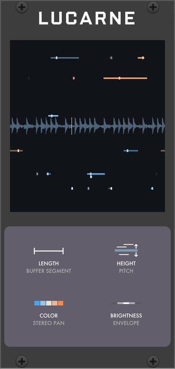

# Robot Boy

**Robot Boy** is a plugin for [VCV Rack](https://vcvrack.com) and the [4ms MetaModule](https://4mscompany.com/metamodule). It contains:

* Mutable Instruments Beads, split into three modules and running on Beads' own source code:
	* **[Particules](Particules.md):** A granular texture processor.
	* **[Retours](Retours.md):** An unusual delay and beat-slicer.
	* **[Ondes](Ondes.md):** A morphing wavetable oscillator.

* **[Brume](Brume.md):** A stereo reverb with an envelope follower, built on the Beads and Clouds reverbs.

* **[Lucarne](Lucarne.md):** A display expander for Particules' and Retours' buffers, grains and delay taps.

* **[Loooop](Loooop.md):** A stereo looper with four independent playheads, and its smaller sibling **[Löp](Loooop.md#löp)**.

* Three characterful stereo filter emulations:
	* **[MF-20](Filters.md#mf-20--the-korg-ms-20-filter):** A Korg MS-20-style filter.
	* **[Onbetap](Filters.md#onbetap--the-formanta-polivoks-filter):** A Polivoks-style multimode filter.
	* **[Vespid](Filters.md#vespid--the-edp-wasp-filter):** An emulation of the EDP Wasp state-variable filter.
---

## Beads, in three modules

### Particules


Beads’s granular texture processor: it records your input and plays back a swarm of short overlapping grains, from lush self-generating clouds to tightly clocked rhythmic slicing. [**[Manual]**](Particules.md)

### Retours


Beads’s hidden delay mode as a standalone delay and beat-slicer, with manual, clocked, or tap-tempo delay times down to audio rates. [**[Manual]**](Retours.md)

### Ondes


A simple VCO built from Beads’s secret morphing wavetable oscillator: one knob picks one of 12 banks, another sweeps through its 16 waveforms. [**[Manual]**](Ondes.md)

## Brume


A stereo reverb that runs either the Beads or the Clouds tank, with every tank parameter on a knob, plus smear, wow, and an envelope follower that moves any knob you haven't patched. [**[Manual]**](Brume.md)

## Lucarne



A display expander for Particules and Retours: it shows the buffer as a waveform with the write head sweeping across it. With Particules it draws every grain as a line whose height is its pitch, whose length is the stretch of buffer it plays, and whose color is its stereo position; with Retours it draws each delay tap as a line from where it reads to the write head. [**[Manual]**](Lucarne.md)

## Loooop + Löp


A stereo RAM looper: capture a loop, then play it back with four independent playheads, each with its own speed, position, length, and jitter. Löp is the single-playhead version. [**[Manual]**](Loooop.md)

## Filters


Three characterful stereo filter emulations, each modeled from the behavior of the original circuit, with added drive. [**[Manual]**](Filters.md).

- **[MF-20](Filters.md#mf-20--the-korg-ms-20-filter):** The smooth, throaty Korg MS-20 filter — a high-pass and low-pass in series, switchable between the OTA and Korg35 revisions.
- **[Onbetap](Filters.md#onbetap--the-formanta-polivoks-filter):** The wild Soviet Polivoks filter — five modes, with explosive resonance and drive.
- **[Vespid](Filters.md#vespid--the-edp-wasp-filter):** The buzzy EDP Wasp filter, in its original British or reimplemented German flavors.

## To install

- **VCV Rack:** download the `.vcvplugin` for your OS from [Releases](https://github.com/gabriel-roth/RobotBoy/releases), place it in `<Rack user folder>/plugins-<os>-<arch>/` (Rack menu: Help → Open User Folder), then restart Rack.
- **MetaModule** (firmware 2.3 or later): download the `.mmplugin` from [Releases](https://github.com/gabriel-roth/RobotBoy/releases), copy it to a `metamodule-plugins` folder (or the root) of an SD card or USB drive, then Scan Disks on the device and select it.

## To build

- **VCV Rack:** requires the [Rack SDK](https://vcvrack.com/downloads).
  ```
  git clone https://github.com/gabriel-roth/RobotBoy
  cd RobotBoy
  make RACK_DIR=<path-to-Rack-SDK> dist
  ```
- **MetaModule:** requires an `arm-none-eabi` cross toolchain and a checkout of [metamodule-plugin-sdk](https://github.com/4ms/metamodule-plugin-sdk) (tag `api-v2.3.0` or later).
  ```
  cmake -S metamodule -B metamodule/build -DMETAMODULE_SDK_DIR=<path-to-metamodule-plugin-sdk>
  cmake --build metamodule/build
  ```
  Output: `metamodule/metamodule-plugins/RobotBoy.mmplugin`.

## Repository layout

One source tree builds both the VCV Rack plugin and the MetaModule plugin.

- **The VCV Rack plugin** is laid out as usual: `Makefile`, `plugin.json`, `src/` and `res/` (panel SVGs) at the top level.
  - `src/beads/vendor/` is the Mutable Instruments Beads and stmlib code (MIT), vendored with RobotBoy's changes kept in one patch file (see its `NOTICE.md`). `src/beads/host/` adapts it for Particules, Retours and Ondes.
- **`metamodule/`** builds the same sources for the 4ms MetaModule with CMake. It also holds the MetaModule panel images and Loooop/Löp's MetaModule-specific code. The VCV build doesn't use it.
- **`panel-specs/`** holds the sources the panel SVGs in `res/` are generated from. Not needed to build.
- **`tests/`** has DSP unit tests and reference models. Not needed to build.
