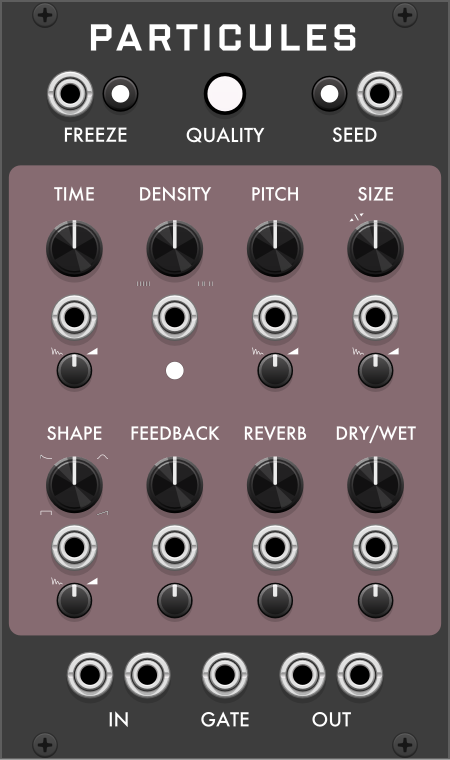
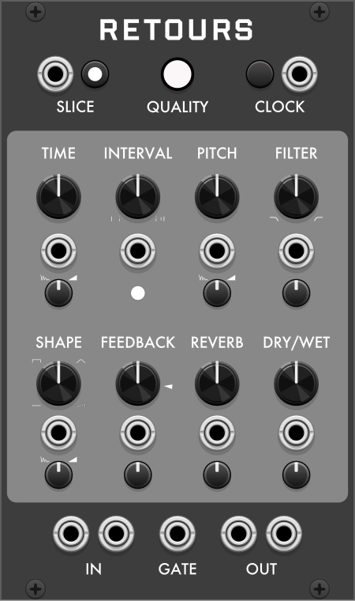
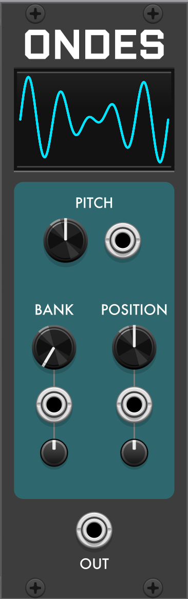
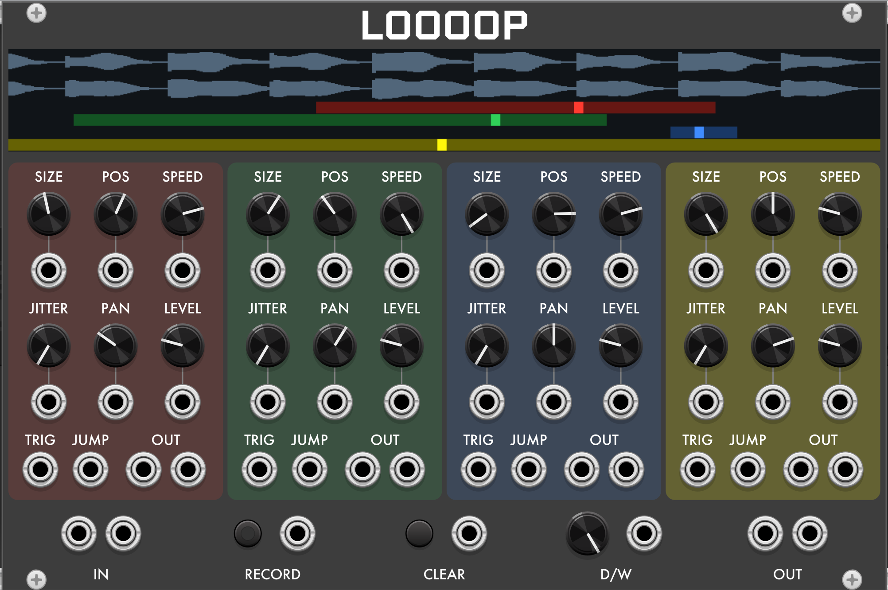
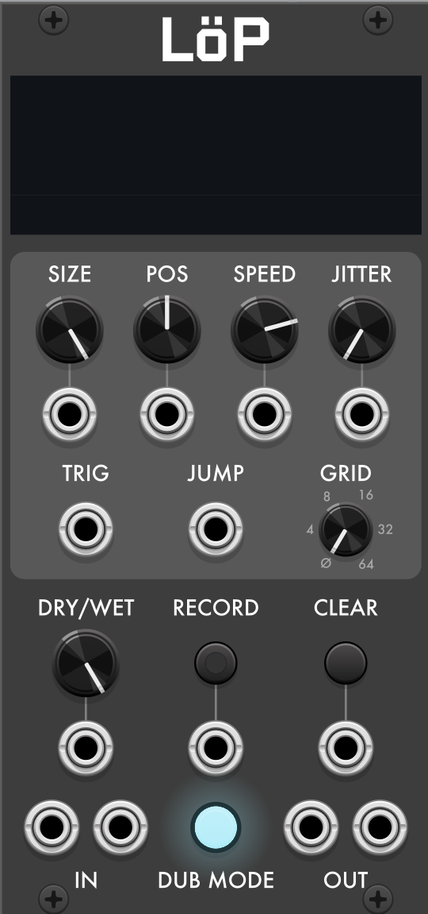
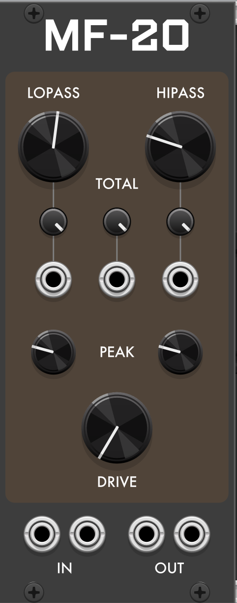
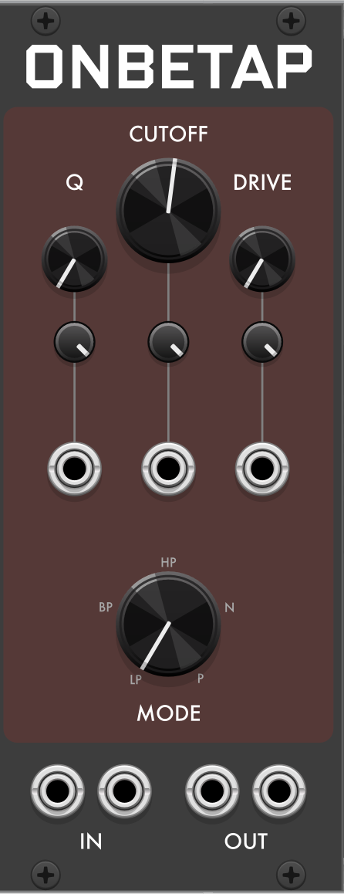
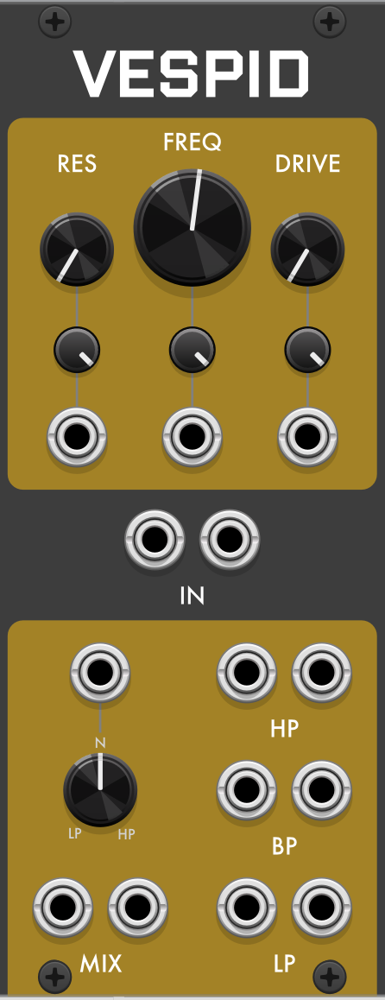
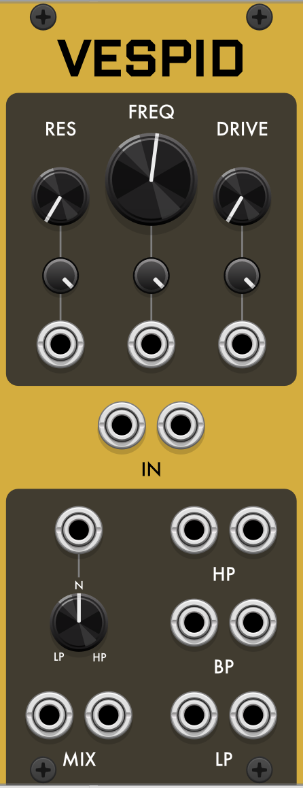

# Robot Boy

**Robot Boy** is a plugin for [VCV Rack](https://vcvrack.com) and the [4ms MetaModule](https://4mscompany.com/metamodule). It contains:

* Three modules built on the open-source code of Émilie Gillet's Beads texture synthesizer:
	* **[Particules](Particules.md):** A granular texture processor.
	* **[Retours](Retours.md):** An unusual delay and beat-slicer.
	* **[Ondes](Ondes.md):** A morphing wavetable oscillator.

* **[Loooop](Loooop.md):** A stereo looper with four independent playheads, and its smaller sibling **[Löp](Loooop.md#löp)**.

* Three characterful stereo filter emulations:
	* **[MF-20](Filters.md#mf-20--the-korg-ms-20-filter):** A Korg MS-20-style filter.
	* **[Onbetap](Filters.md#onbetap--the-formanta-polivoks-filter):** A Polivoks-style multimode filter.
	* **[Vespid](Filters.md#vespid--the-edp-wasp-filter):** An emulation of the EDP Wasp state-variable filter.
---

## Beads, in three modules

### Particules



Beads’s granular texture processor: it records your input and plays back a swarm of short overlapping grains, from lush self-generating clouds to tightly clocked rhythmic slicing. [**[Manual]**](Particules.md)

### Retours



Beads’s hidden delay mode as a standalone delay and beat-slicer, with manual, clocked, or tap-tempo delay times down to audio rates. [**[Manual]**](Retours.md)

### Ondes



A simple VCO built from Beads’s secret morphing wavetable oscillator: one knob picks one of 12 banks, another sweeps through its 16 waveforms. [**[Manual]**](Ondes.md)

## Loooop + Löp




A stereo RAM looper: capture a loop, then play it back with four independent playheads, each with its own speed, position, length, and jitter. Löp is the single-playhead version. [**[Manual]**](Loooop.md)

## Filters






Three characterful stereo filter emulations, each modeled from the behavior of the original circuit, with added drive. [**[Manual]**](Filters.md).

- **[MF-20](Filters.md#mf-20--the-korg-ms-20-filter):** The smooth, throaty Korg MS-20 filter — a high-pass and low-pass in series, switchable between the OTA and Korg35 revisions.
- **[Onbetap](Filters.md#onbetap--the-formanta-polivoks-filter):** The wild Soviet Polivoks filter — five modes, with explosive resonance and drive.
- **[Vespid](Filters.md#vespid--the-edp-wasp-filter):** The buzzy EDP Wasp filter, in its original British or reimplemented German flavors.

## To install

- **VCV Rack:** download the `.vcvplugin` for your OS from [Releases](https://github.com/gabriel-roth/RobotBoy/releases), place it in `<Rack user folder>/plugins-<os>-<arch>/` (Rack menu: Help → Open User Folder), then restart Rack.
- **MetaModule** (firmware 2.3 or later): download the `.mmplugin` from [Releases](https://github.com/gabriel-roth/RobotBoy/releases), copy it to a `metamodule-plugins` folder (or the root) of an SD card or USB drive, then Scan Disks on the device and select it.

## To build

- **VCV Rack:** requires the [Rack SDK](https://vcvrack.com/downloads).
  ```
  git clone https://github.com/gabriel-roth/RobotBoy
  cd RobotBoy/vcv
  make RACK_DIR=<path-to-Rack-SDK> dist
  ```
- **MetaModule:** requires an `arm-none-eabi` cross toolchain and a checkout of [metamodule-plugin-sdk](https://github.com/4ms/metamodule-plugin-sdk) (tag `api-v2.3.0` or later).
  ```
  cmake -S metamodule -B metamodule/build -DMETAMODULE_SDK_DIR=<path-to-metamodule-plugin-sdk>
  cmake --build metamodule/build
  ```
  Output: `metamodule/metamodule-plugins/RobotBoy.mmplugin`.
