# Skylark

**Skylark** is a clocked shape modulator for [VCV Rack](https://vcvrack.com) and the [4ms MetaModule](https://4mscompany.com/metamodule). Each cycle it plays one of 18 shapes; **VARIATION** selects a form within the shape's family, and five transforms reshape the result. It is one of Robot Boy's three complex modulators, with [Weaver](Weaver.md) and [Lyrebird](Lyrebird.md).

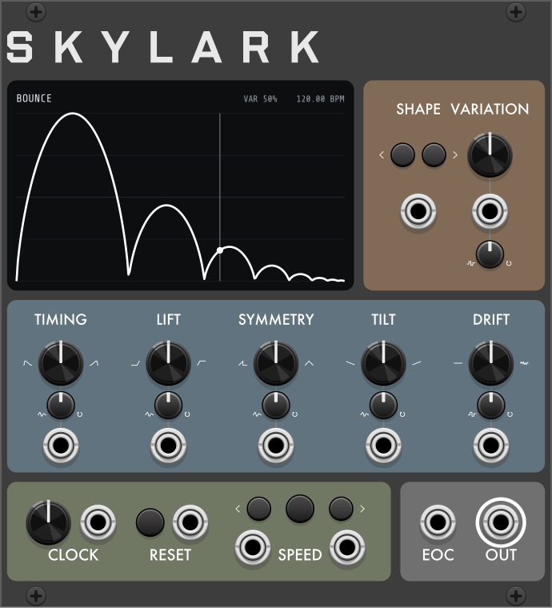

---

## Overview

Skylark is a source of rhythmic, tempo-synced modulation built from recognizable gestures: a bouncing ball, a ratchet, a heartbeat, a spring, an arpeggio. Instead of a plain LFO wave, each bar it plays a shape with internal structure, which suits it to clocked envelopes, accents and movement that sound performed rather than mechanical. Each shape has a family of variations to choose from, the transforms bend it further, and DRIFT or the random trimpots make successive bars differ.

---

## Controls

### SHAPE and VARIATION

- **SHAPE**: selects the shape (default Bounce); **‹ ›** step through them. SHAPE CV adds to the knob, 10 V spanning all 18 shapes, wrapping.
- **VARIATION**: 0–100%, default 50%.

### Transforms

Each transform applies immediately.

- **TIMING**: moves the shape's midpoint earlier or later in the cycle, compressing one half and stretching the other. Default center.
- **LIFT**: bends levels up or down, with the top and bottom fixed. Default center.
- **SYMMETRY**: crossfades the second half of the cycle toward a mirror of the first. At 100% the cycle ends where it starts. Default 0%.
- **TILT**: adds a rising or falling ramp across the cycle, which can push the shape out of range (see **When out of range**). Default center.
- **DRIFT**: randomly offsets the shape's internal parameters each cycle, by up to 30% of their range. The sequence repeats after RESET. Default 0%.

### CV trimpots

VARIATION and each transform have a CV input and trimpot. With a cable patched, the trimpot attenuverts the CV; at full trim, 5 V spans the control's range. With no cable:

- **Clockwise:** feeds **OUT** back into the control.
- **Counter-clockwise:** adds a random offset each cycle. VARIATION and DRIFT change at the cycle start; the other transforms glide between values. The sequence repeats after RESET.

### CLOCK, RESET and SPEED

- **CLOCK**: tempo, 20–300 BPM, default 120. A clock at the input overrides the knob.
- **RESET**: the button or a trigger restarts the cycle and the random sequences.
- **SPEED**: the outer buttons, or triggers at their inputs, halve or double the cycle rate (1/4x to 4x); the center button returns to 1x. A change takes effect at the next point where old and new cycles align, or immediately on RESET.

### Outputs

- **OUT**: the shape, ±5 V by default.
- **EOC**: a trigger at the end of each cycle.

---

## Display

One cycle of the output, with a playhead. The header shows the shape name (below the trace on MetaModule), VARIATION after CV, the tempo, and SPEED when not x1.

---

## The shapes

Each image shows one cycle at VARIATION 0%, 50% and 100%, other controls at defaults. The random shapes repeat exactly each cycle; only DRIFT and the trimpots' random mode vary them.

### Gestures

**1. Bounce**

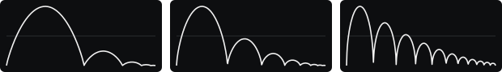

**2. Spring**

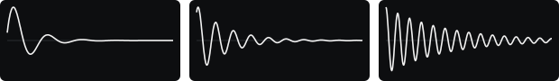

**3. Ratchet**

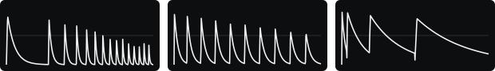

**4. Flam**

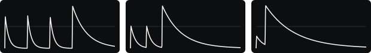

**5. Bowed**

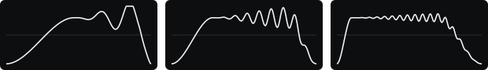

**6. Stutter**

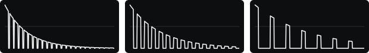

**7. Heartbeat**

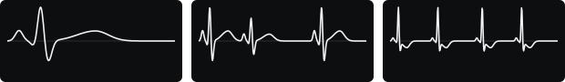

### Cycles

**8. Harmonics**

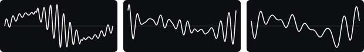

**9. Folded sine**

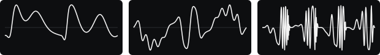

**10. FM**

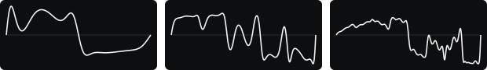

**11. Chirp**

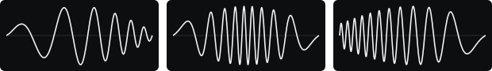

**12. Beating**

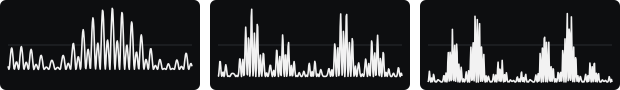

### Steps

**13. Arpeggio**

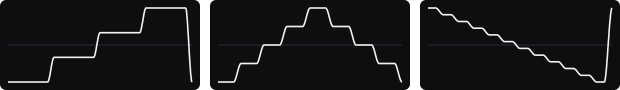

Variation picks the pattern by thirds of its travel: **Up**, **Up-down**, then **Down**.

**14. Ringing steps**

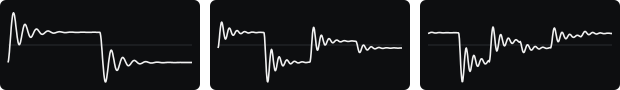

**15. Devil's staircase**

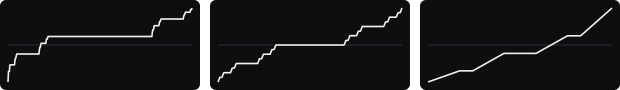

### Chaos

**16. Random nodes**

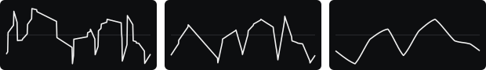

**17. Fractal line**

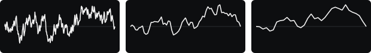

**18. Glitch**

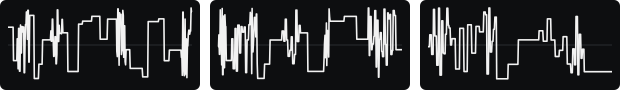

---

## Context menu

- **Output range**: ±5 V (default), ±10 V, 0–5 V, 0–10 V.
- **When out of range**: **Fit** (default; scales the whole cycle down to fit), **Clip**, **Soft clip**, **Fold** or **Wrap**.
- **Slew**: Off (default), 2 ms, 5 ms, 20 ms.
- **Clock pulses per cycle**: pulses per bar at the CLOCK input, 1–96 (default 4).
- **CV and feedback**: **Continuous** (default) or **Sample once per cycle**.
- **Shape changes**: **Immediately** (default) or **At end of cycle**.
