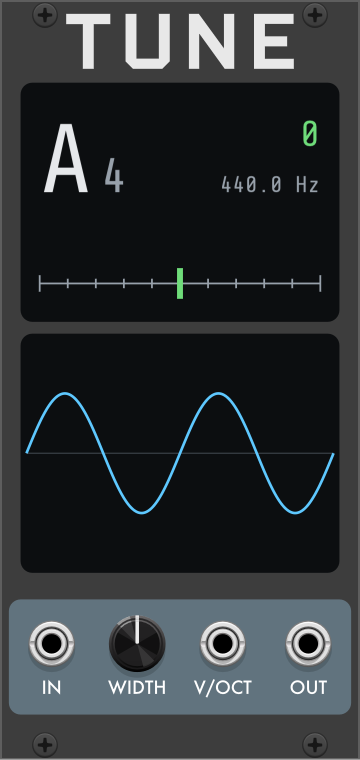

# Tune

**Tune** is a tuner and scope for [VCV Rack](https://vcvrack.com) and the [4ms MetaModule](https://4mscompany.com/metamodule). Its pitch tracking is adapted from the [CV Funk](https://github.com/codygeary/CVfunk-Modules) Tuner by Cody Geary.

---

## Displays

- **Readout:** the nearest note and octave (A4 = 440 Hz), how far the input is from that note in cents, and its frequency in Hz. The marker on the meter below shows the same offset, 50 cents either side of center. The cents value and the marker are green within 2 cents of the note and orange otherwise.
- **Scope:** the input's waveform, starting at a rising zero crossing. The window spans ±10 V.

## Controls

- **IN:** the signal to tune. On a polyphonic cable, the first channel is measured.
- **WIDTH:** how many cycles the scope shows: 2 (default), 4, 6, 8, 10 or 12.
- **V/OCT:** the tracked pitch as a voltage, 0 V = C4.
- **OUT:** a copy of IN.

## Range

Tune follows pitches from about 16 Hz to 6.5 kHz, and slower periodic signals down to about 0.5 Hz, which take several seconds to register.

## Settings

In the options menu:

- **Analysis speed:** Precise, Balanced (default) or Light. Light takes longer to find the pitch and uses less CPU; Precise is the reverse.
