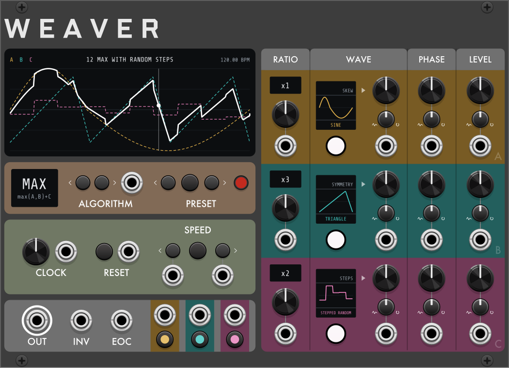

# Weaver

**Weaver** is a clocked three-operator modulator for [VCV Rack](https://vcvrack.com) and the [4ms MetaModule](https://4mscompany.com/metamodule). Three operators (waves or external CV) run at whole-number ratios of a shared cycle and are combined by one of eleven algorithms. It is one of Robot Boy's three complex modulators, with [Skylark](Skylark.md) and [Lyrebird](Lyrebird.md).

---

## Overview

- One cycle = four beats (2 s at 120 BPM), from the **CLOCK** knob's tempo or an external clock. **SPEED** scales the cycle from 1/4x to 4x.
- Operators **A**, **B** and **C** each play a wave at a **RATIO** of the cycle, with **PARAM** (wave shape), **PHASE** and **LEVEL** controls. All operators stay phase-aligned to the cycle.
- The **ALGORITHM** sets how the operators are combined. In most algorithms A and B interact and C is added.
- The result is brought into the output range (default: scaled to fit) and sent to **OUT**, inverted to **INV**. **EOC** fires at each cycle end. **A**, **B** and **C** output each operator's wave.

---

## Controls

### Operators (A, B, C rows)

- **RATIO**: wave repetitions per cycle: 1/8, 1/4, 1/2, x1, x2, x3, x4, x5, x6, x7, x8, x12, x16, x24, x32. RATIO CV adds 1 V per step, rounded and clamped. By default a change waits for a cycle start at which the operator stays aligned (1/2, 1/4, 1/8 can wait up to 2, 4, 8 cycles); the readout shows the pending ratio dimmed. See **Ratio changes** in the context menu.
- **WAVE** button: steps to the next wave. The button's color identifies the wave. In VCV Rack, right-click to choose from a list. See **Waves**.
- **PARAM**: 0–100%, default 50%. Function depends on the wave (see **Waves**).
- **PHASE**: 0–360° offset within the operator's cycle.
- **LEVEL**: −100% to +100%. Negative inverts the wave. In some algorithms LEVEL is a modulation depth (see **Algorithms**).
- **CV trimpots and jacks** (PARAM, PHASE, LEVEL): the trimpot is an attenuverter, default center (no effect). At full clockwise, 5 V spans the control's range; counter-clockwise inverts. PHASE wraps; PARAM and LEVEL clamp.

### Waves

| Wave | Button color | PARAM | Function |
|---|---|---|---|
| Sine | green | SKEW | peak position; 50% = pure sine |
| Triangle | yellow | SYMMETRY | rise/fall ratio; 50% = triangle |
| Ramp up | blue | CURVE | exponential ↔ logarithmic; 50% = linear |
| Ramp down | violet | CURVE | exponential ↔ logarithmic; 50% = linear |
| Square | red | WIDTH | pulse width 2–98% |
| Envelope | orange | ATTACK | attack time as a fraction of the operator cycle; unipolar (0 to +1) |
| Stepped random | white | STEPS | 1–8 random levels per operator cycle |
| Smooth random | pale blue | DENSITY | 1–8 interpolated points per operator cycle |
| Stepped random loop | pink | STEPS | 4–16 random steps, repeating each operator cycle |
| Smooth random loop | aqua | DENSITY | 6–16 interpolated points, repeating each operator cycle |
| Input | magenta | SLEW | external CV; see **Input operators** |

Stepped and Smooth random are non-repeating but identical after each RESET. Selecting a loop wave generates a new pattern for that operator; the pattern is saved with the patch.

### Input operators

With WAVE set to **Input**, the operator plays the signal at its **PARAM** jack:

- **PARAM** jack: the signal. ±5 V = full scale.
- **PARAM** trimpot: input gain, 0–2x, 1x at center.
- **PARAM** knob: input slew, off (fully counter-clockwise) to about 1 s.
- **RATIO** and **PHASE**: no effect. The ratio readout shows `IN`.
- **LEVEL** and its CV: unchanged.

### Algorithms

The **ALGORITHM** button steps through the algorithms; in VCV Rack, right-click to choose from a list. ALGORITHM CV: 10 V spans all eleven (0.9 V per step), added to the button's selection, wrapping. A change applies immediately, or at the next cycle start with **Algorithm changes → At end of cycle**.

A, B and C below mean each operator's wave × its LEVEL unless stated.

| Algorithm | Formula | Function |
|---|---|---|
| MIX | A+B+C | Sum. |
| SCALE | (A scaled by B) + C | B is a VCA on A; B's LEVEL is the depth. LEVEL 0: A unchanged. Positive: A attenuated at B's minima. Negative: at B's maxima. |
| SCALE 2 | A\*B\*C | As SCALE, with A scaled by both B and C, each LEVEL a depth. Nothing added. |
| RING | (A\*B)+C | Product of A and B, plus C. |
| BEND | (A bent by B) + C | B modulates A's phase, up to ±half a cycle at full LEVEL. An Input operator on A passes through unbent. |
| MAX | max(A,B)+C | Higher of A and B, plus C. |
| MIN | min(A,B)+C | Lower of A and B, plus C. |
| XFADE | (A,B) xfaded by C | Crossfade from A to B controlled by C. C's LEVEL (absolute value) is the depth: 0 = equal mix, full = complete A-to-B sweep. |
| FOLD | fold(A+B)+C | A+B wavefolded at full scale, then C added. |
| S&H | (A sampled by B) + C | A sampled at the start of each B cycle (B's RATIO and PHASE set the rate). If B is an Input, sampled on each rising zero crossing of B. B's LEVEL has no effect. |
| GATE | (A gated by B) + C | A passes while B > 0, zero while B < 0 (reversed with negative B LEVEL; always open at B LEVEL 0). |

### Presets

The **PRESET** buttons step backward and forward through 15 factory presets, wrapping. If the current settings match no preset, forward loads preset 1 and back loads preset 15.

- A preset sets each operator's wave, ratio, PARAM, PHASE and LEVEL, and the algorithm. It applies immediately, regardless of the Algorithm and Ratio changes settings.
- Loading realigns the operators to the cycle; outputs glide to the new shape over 10 ms.
- Tempo, SPEED, menu settings and trace buttons are unchanged. In VCV Rack, a preset load can be undone.

| # | Preset | Algorithm |
|---|---|---|
| 1 | Envelope + triangle x16 (default) | MIX |
| 2 | Ramp switched by square | SCALE |
| 3 | Swell with gated ripple | SCALE |
| 4 | Sampled falling ramp | S&H |
| 5 | Struck ring | RING |
| 6 | Grouped swells, rising | SCALE 2 |
| 7 | Bitten sine | MIN |
| 8 | Square to sine and back | XFADE |
| 9 | Folded rising ramp | FOLD |
| 10 | Breathing triangle | BEND |
| 11 | Phase-bent sine | BEND |
| 12 | Max with random steps | MAX |
| 13 | Random accents, fading | SCALE 2 |
| 14 | Random stutter | GATE |
| 15 | Random swell | MIX |

### CLOCK, RESET and SPEED

- **CLOCK** knob: 20–300 BPM, default 120, in 0.01 BPM steps. One cycle = 4 beats.
- **CLOCK** input: overrides the knob. **Clock pulses per cycle** sets the pulses per cycle (default 4). The first pulse aligns the cycle start; from the second pulse, the tempo is measured, averaged over one cycle of pulses, and followed with a phase lock. If the clock stops, the last tempo continues; the cycle realigns when it restarts.
- **RESET** button and input: return to the cycle start and realign all operators. Does not fire EOC. Input triggers on a rising edge above 1 V.
- **SPEED**: the outer buttons halve or double the cycle rate (1/4x, 1/2x, 1x, 2x, 4x); the center button returns to 1x. The jacks under the outer buttons do the same on a rising edge above 1 V. A change waits for the next point where the old and new cycles both start (up to four bars), so the phase stays aligned to the bar; until then the display shows the new speed dimmed and blinking. RESET applies it immediately. Saved with the patch.

### Outputs

- **OUT**: the combined shape. ±5 V by default; ±10 V, 0–5 V or 0–10 V via **Output range**.
- **INV**: OUT inverted around the center of the output range (0 V, 2.5 V or 5 V).
- **EOC**: 10 V, 1 ms trigger at each cycle end (at the SPEED rate).
- **A**, **B**, **C**: each operator's wave at full scale, before LEVEL and the algorithm. In bipolar ranges, Envelope covers only the positive half; in unipolar ranges it covers the full range.
- **Trace buttons** (under A, B, C outputs): show or hide that operator's trace on the main display. Display only; not affected by Randomize.

---

## Display

- **Main display:** one full cycle of OUT after range and out-of-range handling, before slew, with a playhead and a dot at the current value.
  - Each operator × LEVEL is drawn as a dashed line: A amber, B teal, C pink. An operator at LEVEL 0 draws as a flat line unless **Hide traces when operator level at 0** is on.
  - With an Input operator, that operator's trace and the result show the previous cycle as played.
  - Header: A B C legend (a letter dims when its trace is hidden; on MetaModule, followed by the algorithm name); preset number and name when the settings match a preset (below the trace on MetaModule); tempo; SPEED when not x1 (dimmed and blinking while pending).
- **ALGORITHM display:** algorithm name and formula.
- **Per-operator displays:** one cycle of the operator's wave, with the PARAM function above and the wave name below; RATIO readout (`IN` for an Input operator).

---

## Context menu

In VCV Rack, right-click the panel; on MetaModule, open Options.

- **Output range**: ±5 V (default), ±10 V, 0–5 V, 0–10 V. Applies to OUT, INV and A/B/C.
- **When out of range**: how values beyond full scale are handled.
  - **Fit** (default): the whole cycle is scaled down to fit; in-range shapes are unchanged. With an Input operator, fits to the larger peak of the current and previous cycle. A/B/C outputs clip.
  - **Clip**: hard clip.
  - **Soft clip**: saturation curve; also rounds values within range.
  - **Fold**: reflect at the edge.
  - **Wrap**: wrap to the opposite edge.
- **Slew**: Off (default), 2 ms, 5 ms, 20 ms. Applied to all outputs except EOC.
- **Clock pulses per cycle**: 1, 2, 4 (default), 8, 16, 24, 32, 48, 96. 4 = quarter notes, 16 = sixteenths, 96 = 24 PPQN.
- **Algorithm changes**: **Immediately** (default) or **At end of cycle** (button and CV changes wait for the next cycle start or RESET). Presets and patch loads apply immediately.
- **Ratio changes**: **At end of cycle** (default; waits for a cycle start at which the operator stays aligned) or **Immediately** (the wave continues from its current phase at the new rate, offset from the cycle until the next RESET or preset load).
- **New random loops on reset**: on (default) generates new Stepped and Smooth random loop patterns at each RESET.
- **Hide traces when operator level at 0**: off (default).
- **Algorithm** (MetaModule only): selects the algorithm from a list.

**Initialize** (VCV Rack) loads preset 1, sets SPEED to x1 and resets the menu settings. **Randomize** sets all knobs except CLOCK, selects random waves for all operators (excluding Input) and generates new loop patterns. The algorithm is unchanged.
